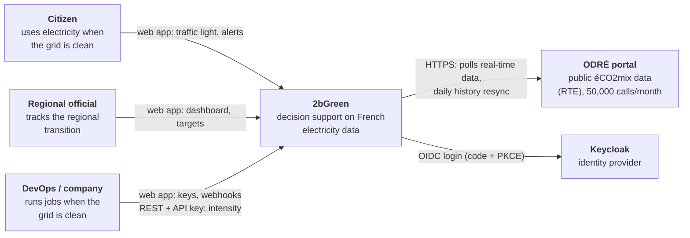
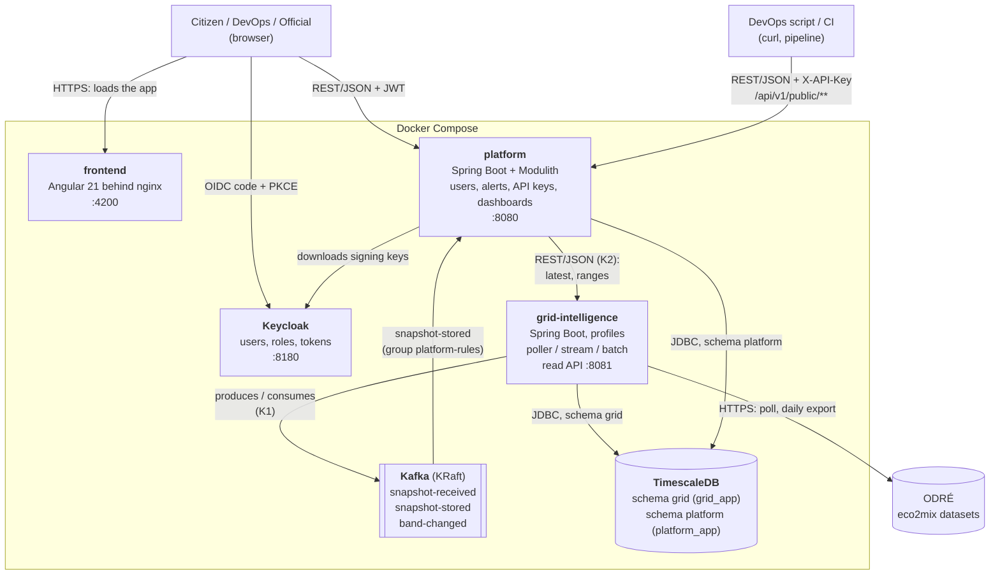
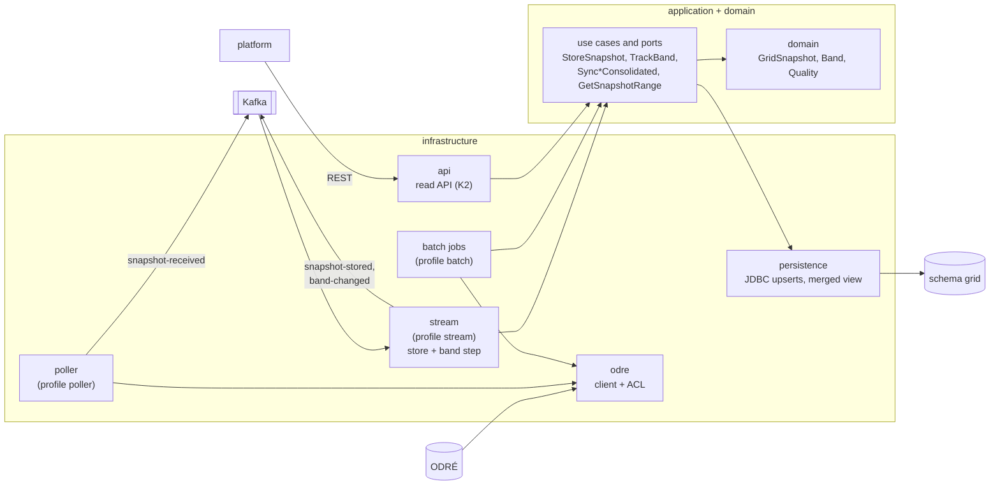
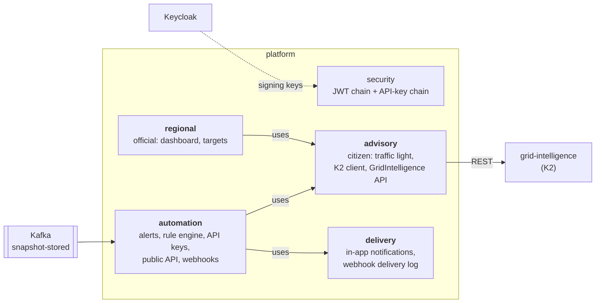
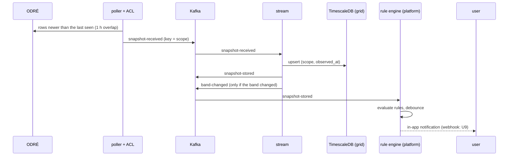

# 2bGreen architecture

Synthesis of the architecture overview of 2026-10-14, updated with what has been built since. Each structuring choice
has an ADR in `docs/adr/`; this page says what the system is, the ADRs say why.

The architecture is shown with the [C4 model](https://c4model.com), from the outside in: system context,
containers, components, then one dynamic view (the journey of a reading). Diagrams are Mermaid, so GitHub renders them.

## C4 level 1: system context

Who uses 2bGreen and which outside systems it depends on.

## C4 level 2: containers

What runs, what each piece owns, and how the pieces talk. Arrows start at the caller; the label is the protocol and,
for Kafka, the topic.

Each container owns one kind of data (ADR-001). `platform` never reads schema `grid`: it uses REST for answers and
Kafka for events (ADR-002). `grid-intelligence` has no authentication and must stay on the internal network.

## C4 level 3: components

### `grid-intelligence` (ports and adapters)

### `platform` (Spring Modulith modules)

Modules use each other's public API or in-process events, and `ModularityTests` fails the build on an illegal
dependency. The Modulith-generated diagrams in `docs/architecture/` show the same dependencies in more detail.

## Dynamic view: journey of one reading

## Data strategy

| Step | Choice | Why | Where |
|---|---|---|---|
| **Collection** | Poll ODRÉ every 15 minutes (real time) and resync the history daily (batch, one count call, exports only for years that changed) | The source is a public pull API with a quota of 50,000 calls per user per month; the batch spends about 1 call on a normal day | ADR-003 |
| **Translation** | Anti-corruption layer: ODRÉ field names never leave `infrastructure.odre`; every number is parsed defensively; `date_heure` (UTC) is the only timestamp | The datasets drift in types and use sentinels (`"ND"`, `"-"`) | `docs/data/` |
| **Processing** | Speed: Kafka Streams stores and publishes, a stateful step tracks the CO2 band. Batch: upsert that never downgrades definitive rows | Order per scope, replay, several consumers (ADR-004) | `docs/contracts/events.md` |
| **Storage** | One TimescaleDB, one schema and one role per app. `speed_snapshot` (15 min, hypertable), `batch_snapshot` (30 min), view `merged_snapshot`; user data in `platform` with a prefix per module | Single writer per table, no cross-schema reads, time-series functions (`time_bucket`) | ADR-001, ADR-003 |
| **Serving** | REST pull for queries (K2), Kafka push for events (K1) | A screen needs an answer now; an alert reacts to an event | ADR-002 |
| **User data** | Alerts, API keys (SHA-256 only), notifications, targets, region code: in `platform` only | The assignment requires processing user data; it stays apart from grid data | `docs/data/user-data.md` |

## Constraints that shaped the design

- **Data source**: ODRÉ lags real time by 15 to 30 minutes, has no retention guarantee for the real-time datasets, and
  has no CO2 for regions (estimated from the mix, always flagged `estimated`). Quota: 50,000 calls per month, so tests
  never call it (CI job `no-live-odre`).
- **Team**: three developers and a few weeks, so few deployables (ADR-001) and tools that run in Compose with one
  command.
- **Volume**: tiny (one message per scope every 15 minutes, 13 scopes), so Kafka is justified by ordering, decoupling
  and replay, not by load (ADR-004).
- **Security**: no password in our apps (ADR-006), only a hash of API keys (ADR-005), `grid-intelligence` internal only.
- **Reproducibility**: the whole stack starts with `docker compose up -d --build`; backend tests use Testcontainers.

## Decisions

| ADR | Decision | Status |
|---|---|---|
| [ADR-001](adr/0001-deployables.md) | Two backends split on the data they own, plus the frontend; `platform` is a modular monolith | Accepted |
| [ADR-002](adr/0002-exchanges-between-apps.md) | REST pull and Kafka push between the apps, no cross-schema reads | Accepted |
| [ADR-003](adr/0003-lambda-architecture.md) | Simplified Lambda: speed and batch tables merged in one view | Accepted |
| [ADR-004](adr/0004-kafka-and-kafka-streams.md) | Kafka as the event log, Kafka Streams for processing | Accepted |
| [ADR-005](adr/0005-api-key-authentication.md) | DevOps scripts authenticate with a hashed API key | Accepted |
| [ADR-006](adr/0006-keycloak-authentication.md) | People log in with Keycloak (OIDC, PKCE), `platform` checks the tokens | Accepted |
| [ADR-007](adr/0007-thresholds-and-shared-band.md) | User thresholds evaluated in `platform`, shared CO2 band in the stream | Accepted |

New ADRs start from [the template](adr/0000-template.md).

## Components

Three programs and three pieces of infrastructure. Each program owns one kind of data.

| Component | Tech | Owns / does | Knows nothing about |
|---|---|---|---|
| `grid-intelligence` (port 8081) | Spring Boot | Electricity data: polls ODRÉ, translates it (anti-corruption layer), moves it through Kafka, processes and stores it, serves an internal read API | Users |
| `platform` (port 8080) | Spring Boot, Spring Modulith | Users and product: alerts, API keys, webhooks, regional dashboard. Checks who calls, asks `grid-intelligence` for grid data | ODRÉ |
| `frontend` (port 4200) | Angular | One area per persona | `grid-intelligence`, Kafka, the database |
| Keycloak (port 8180) | Keycloak | Users, roles, tokens | |
| Kafka (port 9092) | Kafka, KRaft mode | Event log between the apps | |
| TimescaleDB (port 5432) | PostgreSQL 17 + TimescaleDB | One schema per app (`grid`, `platform`), one database role per schema | |

Who calls whom (an arrow starts at the caller):

- frontend → Keycloak: login. frontend → `platform`: every business request, with the token.
- `platform` → Keycloak: downloads the signing keys once, then checks tokens itself.
- `platform` → `grid-intelligence`: REST, read API (contract K2, `docs/api/openapi.yaml`).
- `grid-intelligence` → ODRÉ: the poller and the batch.
- Both apps → Kafka (contract K1, `docs/contracts/events.md`) and → TimescaleDB, each in its own schema.

## Journey of one reading (every 15 minutes)

ODRÉ `*-tr` → **poller + ACL** → `grid.snapshot-received` → **stream** → `grid.speed_snapshot` →
`grid.snapshot-stored` → **rule engine** of `platform` (alerts, webhooks), and → **band step** of the stream →
`grid.band-changed`.

1. **Poller and ACL** (`poller` profile). Asks ODRÉ for rows newer than the last one seen, with a 1-hour overlap. The
   ACL skips forecast-only rows, parses every number defensively, uses only the UTC timestamp and builds the team's
   own `GridSnapshot`. Regional rows get an estimated CO2 (regional data publishes none, `docs/data/regional-co2.md`).
2. **Kafka.** Key = scope (`national` or `region:<INSEE code>`), so the readings of a scope stay in order.
3. **Stream** (`stream` profile, Kafka Streams). Upserts the snapshot on (`scope`, `observed_at`), then publishes
   `grid.snapshot-stored`. A stateful step keeps the last CO2 band per scope and announces band changes.
4. **`platform`** reacts to `grid.snapshot-stored`: the rule engine compares each user's thresholds and notifies.

Delivery is at least once; idempotent upserts make a duplicate harmless.

## History: speed and batch paths

| Path | Source | Writer | Table | Grain |
|---|---|---|---|---|
| Speed | `eco2mix-national-tr`, `eco2mix-regional-tr` | stream | `speed_snapshot` | 15 min, provisional |
| Batch | `eco2mix-national-cons-def` (since 2012), `eco2mix-regional-cons-def` (dataset from 2013, loaded from 2021) | daily job (`batch` profile) | `batch_snapshot` | 30 min, consolidated or definitive |

The view `grid.merged_snapshot` serves ranges: for a half hour the batch row wins, otherwise the provisional
quarter-hours are averaged (`docs/data/merged-view.md`). The batch does not use Kafka.

## A user opens a page

1. The frontend sends the user to Keycloak (code + PKCE) and gets a JWT access token.
2. The frontend calls `platform` with the token.
3. `platform` checks the token and the role **before** asking for any grid data.
4. `platform` calls the read API of `grid-intelligence`, which never sees the user.
5. `platform` computes the answer (traffic light, dashboard...) and returns it.

DevOps scripts use the second path: an API key on `/api/v1/public/**` (ADR-005).

## Inside the apps

- **`grid-intelligence`**: ports and adapters. `domain` (pure), `application` (use cases and ports),
  `infrastructure` (`odre`, `poller`, `messaging`, `stream`, `persistence`, `api`). ArchUnit checks that `domain` stays
  pure, that `application` does not depend on `infrastructure` and that only `infrastructure.odre` knows ODRÉ.
- **`platform`**: four Spring Modulith modules, one per bounded context (Citizen Advisory, Carbon-Aware API,
  Regional Transition, Delivery; Grid Intelligence is the other app), each with `application` / `domain` / `infrastructure`:
  `advisory` (citizen, and the K2 client), `automation` (alerts, rule engine, API keys, public API), `regional`
  (official), `delivery` (in-app notifications, webhook delivery log). Modules use each other's public API or
  in-process events; `ModularityTests` checks it. Each module owns its tables (prefix `advisory_`, `automation_`...),
  with no foreign key between modules (`docs/data/user-data.md`). Module diagrams: `docs/architecture/`.

## Tools

| Tool | Why | Where |
|---|---|---|
| Java 21, Spring Boot 4.1.1, Maven | One stack for both backends | both apps |
| Spring Modulith | Module boundaries tested inside one app | `platform` |
| Spring Data JDBC / plain JDBC | Aggregates in `platform`; bulk upserts and time queries in `grid-intelligence` | |
| Flyway | Each app creates its own schema at startup | both apps |
| PostgreSQL + TimescaleDB | Time-series tables, `time_bucket` for the merged view | both schemas |
| Kafka (KRaft), Kafka Streams | Ordered event log, stateful processing without a cluster | |
| Keycloak | Login, users, roles, tokens | |
| Angular 21 | One app, one area per persona | `frontend` |
| Docker Compose | The whole stack with one command | |
| Testcontainers, ArchUnit, Vitest | Tests on a real database and broker, architecture rules, frontend tests | CI |

## Open points

- Traffic-light and band limits (20 and 40 gCO2eq/kWh): a proposal from autumn data, to validate as a team.
- What the 30-minute value of cons-def represents (mean or `:00` reading), which decides if the merged view's average
  is exact.
- The batch's real pre-computation (typical CO2 by hour and weekday, G5).
- Invalid Kafka messages: logged and skipped, or a dead-letter topic.
- Whether the Regional Transition subdomain is Core or Supporting.
