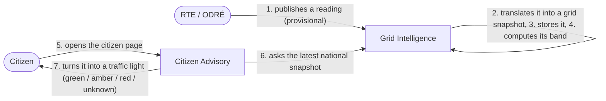
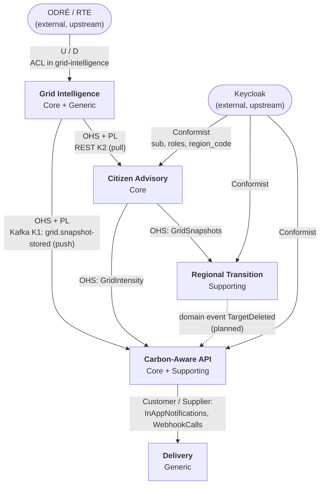

# 2bGreen domain analysis (DDD)

What 2bGreen is for, who uses it, which data it works on, and how the domain is cut and modelled with Domain-Driven
Design. This page is the problem side; [`architecture.md`](architecture.md) and the ADRs are the solution side. Every
model element named here exists in the code under the same name unless it is marked *planned*.

Status used below: **built** (merged on `main`), **partial** (domain and storage exist, the feature is not finished),
**planned** (open issue).

## 1. The need

### 1.1 Problem and objectives

The carbon intensity of French electricity changes a lot within a day and between days: over 6,234 national readings of
autumn 2026 the median was 24 gCO2eq/kWh and the maximum 65 (README, traffic-light section). The same kWh consumed at 14:00 or at
19:00 does not have the same impact. RTE publishes this data openly (éCO2mix, through the ODRÉ portal), but as raw
tables of MW per source, hard to act on.

2bGreen turns that public data into **decisions**: *when to consume, when to compute, and how each region is doing*.

| Objective | Measured by |
|---|---|
| Tell anyone, at a glance, whether now is a good time to use electricity | Traffic light per reading, freshness flag |
| Let people and machines react automatically when the grid gets clean | Alerts, public API, webhooks |
| Give regional officials a faithful picture of their region against the nation | Regional dashboard, targets |
| Never show a value more reliable than it is | Quality of every reading (provisional, consolidated, definitive), `estimated` flag, `stale` flag |

### 1.2 Personas

The same grid reading is shown differently to each persona.

| Persona | Role (Keycloak) | Goal | Pain today | What 2bGreen shows them |
|---|---|---|---|---|
| **Citizen** (e.g. a household in Nice) | `citizen` | Run the dishwasher, washing machine or EV charge when the grid is clean | Does not read MW tables; does not know when "clean" is | A traffic light, alerts below their own threshold, *planned*: best slot for a usage, usage log |
| **DevOps / company** (e.g. a team running nightly CI jobs) | `devops` | Run flexible workloads (batch jobs, trainings, builds) when the grid is clean: carbon-aware computing | Needs a machine-readable signal, not a web page | A REST API authenticated by API key with a daily quota, *planned*: conditional webhooks, best window for a job |
| **Regional official** (e.g. an energy officer of Provence-Alpes-Côte d'Azur) | `regional_official` | Follow and report on the region's energy transition | Regional data has no CO2 value and comes hours late; comparing with the nation is manual | A dashboard of their own region next to the nation (energy balance, coverage rate, renewable share), *planned*: targets with progress and pace alerts |

### 1.3 Data collected

**Measured data (the "sensors").** 2bGreen has no sensor of its own: RTE's metering of the grid is the sensor, and
éCO2mix is its public output. Four datasets (details in `docs/data/`):

| Dataset | Content | Grain | Quality | How we get it |
|---|---|---|---|---|
| `eco2mix-national-tr` | Consumption, production by source, forecasts, CO2 | 15 min | Provisional | Polled every 15 min (speed layer) |
| `eco2mix-regional-tr` | Same for 12 regions, **no CO2, no forecasts**, fossil as one aggregate | 15 min | Provisional | Polled every hour |
| `eco2mix-national-cons-def` | History since 2012 | 30 min | Consolidated, then definitive | Daily resync (batch layer) |
| `eco2mix-regional-cons-def` | Regional history, dataset from 2013 (code default loaded from 2021, Compose default: region 93 from 2025, see README) | 30 min | Consolidated, then definitive | Daily resync |

How these datasets flow through the speed and batch paths (writers, tables, merged view) is in
[`architecture.md`](architecture.md#history-speed-and-batch-paths). 13 scopes in all (France and 12 regions). Regional CO2 is **estimated** by 2bGreen from the production mix
(`docs/data/regional-co2.md`).

**Data entered by users** (full inventory: `docs/data/user-data.md`):

| Persona | Entered data | Status |
|---|---|---|
| Citizen | Alert threshold, chosen usages, usage log, chosen region | Alerts built; the rest planned (tables exist) |
| DevOps | API keys (stored as a hash), webhooks (URL, condition, secret) | Keys built; webhooks partial |
| Official | Targets (indicator, reference year, target value, deadline, tolerance) | Planned (tables exist). The official's region is a Keycloak attribute, not entered in 2bGreen |
| Produced by the system for users | Notifications, webhook delivery log, API key call counters, rule state, target progress | Notifications, counters and rule state built |

### 1.4 Features and value per actor

| Feature | Persona | Issue | Status | Value |
|---|---|---|---|---|
| Traffic light of the national grid | Citizen | F5 | Built | Decide in one second, no expertise needed |
| Clean-grid alert below my threshold | Citizen | U2 | Built | No need to watch the app: it tells you |
| In-app notification box | Citizen, official | U2, U16 | Built | One place for everything 2bGreen told you |
| Today's mix, cleanest hours map | Citizen | U1, U5 | Planned | Understand *why* the grid is clean |
| Best slot for a usage, usage log | Citizen | U4, U6 | Planned | Plan ahead; see your own impact |
| Carbon-intensity API (latest, 7-day range) | DevOps | U7 | Built | Pipelines can ask "is now a good time?" |
| API keys with a daily quota | DevOps | U10 | Built | Safe programmatic access, revocable |
| Conditional webhooks | DevOps | U9 | Partial | Push instead of polling |
| Best window for a job | DevOps | U8 | Planned | Schedule a job of N hours before a deadline |
| Regional dashboard vs the nation | Official | U11 | Built | Faithful regional picture, with estimated CO2 flagged |
| Trends, comparison between regions | Official | U12, U14 | Planned | Reporting material |
| Targets, progress, pace alert | Official | U13, U16 | Planned | Steer the transition, be warned when late |

For **RTE / ODRÉ**, 2bGreen is a consumer that respects the quota (50,000 calls per month; a normal day of batch costs
one call). For the **team**, the value is a design where each persona's features can change without touching grid
ingestion.

## 2. Ubiquitous language

One word, one meaning, used in the code, the contracts and this documentation. Names in `code` are the class or field
that carries the term.

### 2.1 Grid

| Term | Definition | In the code | Not to confuse with |
|---|---|---|---|
| **Grid snapshot** | One reading of the grid for one scope and one period: consumption, production by source, CO2. Identified by (scope, observed at) | `GridSnapshot` | A raw ODRÉ row (never leaves the ACL) |
| **Scope** | What a snapshot describes: `national`, or `region:<INSEE code>` | `scope`, `GridScope` | A geographic location of a user (never collected) |
| **Observed at** | UTC start of the period the snapshot describes | `observedAt` | `storedAt`, when we saved it |
| **Carbon intensity** | Direct CO2 emissions of production divided by total production, in gCO2eq/kWh. Imports not counted | `co2Intensity` | "Pollution", or a consumption footprint |
| **Estimated** | The carbon intensity was computed by 2bGreen from the mix (regions), not published by RTE | `estimated` | A forecast |
| **Production mix** | Production by source in MW: nuclear, gas, coal, oil, thermal, wind, solar, hydro, bioenergy | `Production`, `GridMix` | |
| **Thermal** | All fossil production as one figure. Regional data only gives this; for France it is gas + coal + oil | `thermal` | Bioenergy (also combustion, counted apart) |
| **Pumping** | Power drawn to pump water uphill. Zero or negative | `pumping` | Hydro production |
| **Quality** | How reliable a reading is. Only moves forward: **provisional** (real time) → **consolidated** → **definitive** | `Quality`, `GridQuality` | ODRÉ's `nature` field |
| **Speed layer / batch layer** | The two paths of a reading: provisional every 15 min, consolidated and definitive once a day | `speed_snapshot`, `batch_snapshot` | |
| **Merged view** | The single 30-min series where a batch row wins over provisional quarter-hours | `merged_snapshot` | |
| **Missing value** | A measure the source did not give. Always unknown, **never 0** | `null` everywhere | Zero production |

### 2.2 Signals and personas

| Term | Definition | In the code |
|---|---|---|
| **Band** | The shared three-step level of a scope: green below 20, amber below 40, red from 40 gCO2eq/kWh. A value equal to a limit belongs to the worse band | `Band`, `BandPolicy` |
| **Band change** | The band of a scope changed between two snapshots | `BandChange`, topic `grid.band-changed` |
| **Traffic light** | The citizen's view of the band, plus `UNKNOWN` when there is no value or it is too old | `TrafficLight`, `TrafficLightLevel` |
| **Stale** | A reading too old to describe the grid now (2 h for the traffic light, 4 h for the regional dashboard) | `stale` |
| **Threshold** | A user's own limit in gCO2eq/kWh | `threshold` |
| **Alert rule** | A citizen's subscription: "tell me when national CO2 goes below my threshold". At most 5 | `AlertRule` |
| **Crossing** | The moment a condition becomes true. A subject notifies once per crossing, then is **armed** again when the condition becomes false | `Crossing`, `CrossingPolicy`, `RuleStatus` (`ARMED`, `FIRED`) |
| **Debounce** | Minimum time between two notifications of the same subject | `minInterval` |
| **Notification** | A message in the user's in-app box | `Notification` |
| **API key** | A DevOps credential for the public API. Shown once, stored as a SHA-256 hash | `ApiKey` |
| **Quota** | 1,000 accepted calls per key per UTC day | `automation.api-keys.daily-quota` |
| **Webhook** | A URL called when a condition (below, above, band changed) becomes true. At most 10 | `Webhook`, `WebhookCondition` |
| **Delivery** | One attempt to call a webhook, logged without payload | `WebhookDelivery` |
| **Usage** *(planned)* | Something a citizen can shift in time, with a duration (dishwasher, 3 h) | `Usage` |
| **Best slot / best window** *(planned)* | The start time that minimises carbon intensity for a usage or a job | |
| **Energy balance** | Consumption against production of a scope at one reading | `EnergyBalance` |
| **Coverage rate** | Production / consumption, %. Above 100 the scope exports | `coverageRate` |
| **Renewable share** | (wind + solar + hydro + bioenergy) / production, % | `renewableShare` |
| **Importing / exporting** | The scope produces less / more than it consumes | `BalanceDirection` |
| **Target** *(planned)* | An official's goal for their region: an indicator, a reference year, a target value, a deadline | `Target`, `TargetIndicator` |
| **Trajectory, tolerance, pace** *(planned)* | The expected path from reference to target; the allowed gap in points; whether the region is ahead, on track or late | `TargetStatus`, `tolerance` |

### 2.3 One concept, one model per context

"A reading of the grid" exists in four contexts, each with **its own model** holding only what it needs. This is a
deliberate DDD choice, not duplication: each context translates the contract into its own language.

| Context | Model | Holds |
|---|---|---|
| Grid Intelligence | `GridSnapshot` | Everything, plus quality and the estimation rule |
| Citizen Advisory | `GridReading` | CO2, quality, freshness, mix |
| Carbon-Aware API (rule engine) | `GridObservation` | Scope, observed at, CO2: nothing else |
| Regional Transition | `EnergyBalance` (computed from `advisory.GridSnapshot`) | Consumption against production, rates |

## 3. Domain stories

Written in the Domain Storytelling style: *actor → activity → work object*, numbered in order. Built stories first.

### DS1. A reading becomes a traffic light (citizen, built)

1. RTE publishes a provisional national reading on ODRÉ.
2. Grid Intelligence fetches it and translates it into a **grid snapshot** (ODRÉ names stay at the border).
3. Grid Intelligence stores the snapshot (upsert on scope, observed at).
4. Grid Intelligence updates the **band** of the scope and announces a **band change** if there is one.
5. The citizen opens the app.
6. Citizen Advisory reads the latest national snapshot.
7. Citizen Advisory turns it into a **traffic light**; a reading older than 2 hours lights nothing (`UNKNOWN`, stale).

### DS2. A citizen is told the grid is clean (built)

1. The citizen creates an **alert rule** with a threshold of 15 gCO2eq/kWh.
2. Grid Intelligence stores a new national snapshot and announces it (`grid.snapshot-stored`).
3. The rule engine (Carbon-Aware API) compares the snapshot with every active rule of that scope.
4. For this rule the condition becomes true: it is a **crossing**, the rule goes from armed to fired.
5. Delivery writes a **notification** in the citizen's box ("Réseau propre : 12 gCO₂eq/kWh le 12/11 à 14:00, sous votre seuil de 15.").
6. The next snapshots stay below 15: nothing is sent (one notification per crossing; a replayed event is ignored).
7. CO2 goes back above 15: the rule is armed again for the next crossing.

### DS3. A pipeline asks whether to run now (DevOps, built)

1. The DevOps user creates an **API key** in the web app; the key is shown once, 2bGreen keeps its hash.
2. The CI pipeline calls the public API with the key (`X-API-Key`).
3. Carbon-Aware API checks the key (exists, not revoked) and counts the call against the **quota**.
4. Carbon-Aware API returns the latest carbon intensity, or a range of at most 7 days.
5. The pipeline starts the job, or waits. Above 1,000 calls in a UTC day, it gets a 429 with `Retry-After`.

### DS4. An official compares their region with France (built)

1. An administrator assigns a region code to the official in Keycloak (the official cannot change it).
2. The official opens the dashboard.
3. Regional Transition reads the region from the token, never from the request.
4. It asks the latest regional snapshot (CO2 **estimated**) and the national snapshot of the same half hour.
5. It computes the **energy balance** of both: coverage rate, renewable share, importing or exporting.
6. The official sees both, with the estimated flag and the freshness of the regional reading (regional data is
   normally 1 to 3 hours late; stale beyond 4 hours, still shown).

### DS5. History becomes definitive (batch, built)

1. Once a day, Grid Intelligence asks ODRÉ how many rows each year holds, per quality (one call).
2. It compares the counts with the ones recorded at the last load.
3. For each year that changed, it downloads the year again and upserts the rows.
4. A **definitive** row is never replaced by a consolidated one: quality only moves forward.
5. From then on, the merged view returns the batch row for that half hour instead of the provisional quarter-hours,
   and every persona sees the more reliable value without doing anything.

### DS6. An official is warned the region is late (planned, U13 and U16)

1. The official sets a **target**: renewable share of 45 % by 2030, reference year 2023, tolerance 2 points.
2. Regional Transition computes the reference value once, at creation.
3. Each day after the regional resync, it records the **target progress** (value, status ahead / on track / late).
4. When the region leaves its trajectory by more than the tolerance, the rule engine fires a crossing and Delivery
   writes a `TARGET_PACE` notification.
5. When the official deletes the target, Regional Transition publishes `TargetDeleted` and the rule engine forgets
   its state.

## 4. Subdomains

The problem space, before any code. The classification decides where the team spends its effort.

| Subdomain | Type | Why |
|---|---|---|
| **Grid Carbon Intensity**: turn raw readings into a reliable carbon signal (quality lifecycle, regional estimation, band, merged view) | **Core** | Every persona's value depends on it, and it is where 2bGreen differs from the raw data: honest quality, estimated regional CO2, one series over two sources |
| **Flexible Usage Planning** (citizen): traffic light, alerts, best slot, usage log | **Core** | The product promise to the general public: "when should I consume?" |
| **Carbon-Aware Scheduling** (DevOps): API, webhooks, best window | **Core** | Same signal, different differentiation: machines, not people. "Same data, different personas" shows in the split itself |
| **Regional Transition Tracking** (official): dashboard, targets, reporting | **Supporting** | Real and specific work, but mostly "aggregate and compare". It is the first scope the team would cut under time pressure, which is the test for Supporting |
| **Alerting** (rule evaluation: crossing, replay, debounce) | **Supporting** | Specific to 2bGreen, serves the three Core and Supporting subdomains above, but is not what users come for |
| **Notification Delivery** (in-app box, HTTP calls, delivery log) | **Generic** | A solved problem (an outbox, an HTTP client with retries) |
| **Grid Data Ingestion** (poll ODRÉ, page through exports, parse sentinels, respect the quota) | **Generic** | ETL against a public API. A real dependency, but nothing differentiating. Kept as a subdomain on purpose: it is where the `tr` / `cons-def` reconciliation starts |
| **Identity and Access** (users, roles, login, API keys) | **Generic** | Keycloak covers people; API keys are a standard pattern (hash, prefix, quota) |

Three Core subdomains is a lot for three people. That is why Regional Transition is Supporting and why Ingestion,
Delivery and Identity rely on standard tools (Kafka, Keycloak, Spring) rather than custom code.

## 5. Bounded contexts

The solution space: where one model and one language hold. Subdomains and contexts do not map one to one, and that
is normal.

| Bounded context | Covers subdomains | Lives in | Owns (storage) | Knows nothing about |
|---|---|---|---|---|
| **Grid Intelligence** | Grid Carbon Intensity, Grid Data Ingestion | App `grid-intelligence` | Schema `grid`: `speed_snapshot`, `batch_snapshot`, `batch_sync_state`, view `merged_snapshot`; Kafka state store of the band | Users |
| **Citizen Advisory** | Flexible Usage Planning | `platform`, module `advisory` | `advisory_usage`, `advisory_usage_log_entry`, `advisory_region_preference` | ODRÉ |
| **Carbon-Aware API** | Carbon-Aware Scheduling, Alerting, API keys of Identity | `platform`, module `automation` | `automation_alert_rule`, `automation_api_key`, `automation_api_key_daily_counter`, `automation_webhook`, `automation_rule_state` | ODRÉ, how notifications are sent |
| **Regional Transition** | Regional Transition Tracking | `platform`, module `regional` | `regional_target`, `regional_target_progress` | ODRÉ, users' other data |
| **Delivery** | Notification Delivery | `platform`, module `delivery` | `delivery_notification`, `delivery_webhook_delivery` | Why a notification is sent |
| *Identity (external)* | People of Identity and Access | Keycloak | Users, roles, `region_code` attribute | Everything in 2bGreen |

Choices worth explaining:

- **Ingestion and carbon intensity share one context.** They share one model (the grid snapshot) and one team track.
  The split between them is inside the context: the anti-corruption layer `infrastructure.odre` is the only package
  that knows ODRÉ, and ArchUnit fails the build if anything else imports it.
- **Citizen alerts live in Carbon-Aware API.** The rule engine is one mechanism (crossing, replay, debounce) for alert
  rules, webhooks and later target pace. Splitting it per persona would mean three copies of the hardest logic.
  The cost: the context's name is narrower than its content. Its module name, `automation`, describes it better.
- **Delivery is its own context** so that the engine decides *whether* to notify and Delivery decides *how*. Adding a
  channel (e-mail) touches Delivery only.
- **A context is a module, not a microservice** (ADR-001). The boundary inside `platform` is enforced by Spring
  Modulith (`ModularityTests`) and by table ownership with no foreign key between modules; the boundary around Grid
  Intelligence is a separate deployable with its own database role.

## 6. Context map

Arrows go from upstream (U) to downstream (D).

| Relation | Pattern | What it means here | Where in the code |
|---|---|---|---|
| ODRÉ → Grid Intelligence | **Anti-corruption layer** | ODRÉ does not know us and its data drifts (types, `"ND"` and `"-"` sentinels, French field names, local and UTC times). The ACL parses defensively, keeps only `date_heure` (UTC), skips forecast-only rows and builds our `GridSnapshot` | `infrastructure.odre` (`*Mapping`, `*Record`, `OdreNumbers`) |
| Grid Intelligence → `platform` | **Open host service + published language** | Two versioned contracts, in domain language: K1 (Kafka events) and K2 (read API). Changing them needs a PR that tags all three members | `docs/contracts/events.md`, `docs/api/openapi.yaml`, contract tests on both sides |
| Grid Intelligence → `platform` | **Customer / supplier** | `platform` is the customer: K2 ranges and the regional scopes were added because the dashboard needed them | issues K2, G8 |
| K2 → Citizen Advisory | **Anti-corruption layer (small)** | Advisory owns the K2 client and maps the JSON into its own `GridReading`. Its port `GridReadings` hides REST, and a stub mode replaces it in tests | `advisory.infrastructure.RestGridReadings`, `StubGridReadings` |
| Citizen Advisory → Carbon-Aware API, Regional Transition | **Open host service** (in-process) | Advisory is the only module that talks to Grid Intelligence and exposes a small public API to the others, so there is one client and one error model (`GridUnavailableException`) | `advisory.GridIntensity`, `advisory.GridSnapshots` |
| Carbon-Aware API → Delivery | **Customer / supplier** | Delivery offers two channels; the engine calls them inside its own transaction, so a notification exists exactly when the rule state moved | `delivery.InAppNotifications`, `delivery.WebhookCalls` |
| Regional Transition → Carbon-Aware API | **Domain event** *(planned)* | When a target is deleted, the engine must forget its rule state. No foreign key between modules, so an in-process event carries it | `RuleStateRepository` delete by subject; `TargetDeleted` to add with U13 |
| Keycloak → `platform` contexts | **Conformist** | We take Keycloak's model as it is: the `sub` claim is the user id, realm roles are the personas, `region_code` is the official's region | `config.SecurityConfig`, `userId` fields |
| Band limits, Grid Intelligence and Citizen Advisory | **Separate ways** (for code) | Both need the 20 / 40 limits. The first design had a shared kernel `Threshold`; we dropped it because shared code between two deployables couples their releases. The values are written twice and each side has its own test | `stream.band.*`, `advisory.traffic-light.*`, ADR-007 |

Known weakness: nothing checks automatically that the two copies of the band limits are equal (ADR-007).

## 7. Tactical design

Only the building blocks that carry a rule are listed. In `grid-intelligence` the domain is pure Java (checked by
ArchUnit); in `platform` entities are records with Spring Data JDBC annotations, a trade-off accepted in ADR-001.

### 7.1 Grid Intelligence

| Element | Kind | Rule it protects |
|---|---|---|
| `GridSnapshot` | **Entity**, aggregate root of its own aggregate | Identity (scope, observed at). Scope, time and quality are required. Its row has a lifecycle: the same identity moves from provisional to consolidated to definitive |
| `Production` | Value object | Every source nullable: missing is unknown, never 0 |
| `Quality` | Value object (enum) | Derived by our pipeline, never read from ODRÉ on real-time data. Only moves forward |
| `Band`, `BandState` | Value objects | A state remembers the newest `observedAt` seen, so a replay or a late reading cannot move it back |
| `BandPolicy` | Value object with behaviour (policy) | Limits ordered (green below amber); equal goes to the worse band |
| `RegionalCo2Estimator` | **Domain service** | Same definition as RTE's national value; fossil gets the gas factor (429), bioenergy 494; if any source is missing there is no estimate at all; result flagged `estimated` |
| `TrackBand` | Application service, pure | First snapshot of a scope announces its band; same band changes nothing; older or CO2-less snapshots are ignored |
| `StoreSnapshot`, `SyncNationalConsolidated`, `SyncRegionalConsolidated`, `PollNationalReadings`, `PollRegionalReadings`, `GetLatestSnapshot`, `GetSnapshotRange` | Application services (use cases) | e.g. the speed table only accepts provisional snapshots; the poll cursor moves only after every reading is published (duplicates, never gaps) |
| `SpeedSnapshotRepository`, `BatchSnapshotRepository`, `SnapshotReader`, `BatchSyncState` | **Repositories** (ports, JDBC adapters) | Idempotent upserts on (scope, observed at); the batch upsert never replaces definitive with consolidated |
| `OdreGateway`, `SnapshotPublisher` | Ports | The application never sees ODRÉ or Kafka types |

**Domain events** (published language K1, Kafka, key = scope):

| Event | Produced when | Consumed by | Status |
|---|---|---|---|
| `grid.snapshot-received` | The poller translated a new provisional reading | Stream of Grid Intelligence | Built |
| `grid.snapshot-stored` | The reading is saved and readable through K2 | Rule engine of Carbon-Aware API | Built |
| `grid.band-changed` (`BandChange`) | The band of a scope changed | Nobody yet (planned: `BAND_CHANGED` webhooks) | Built |

`snapshot-stored` exists separately from `snapshot-received` so that `platform` is never told about a reading it
cannot read yet. Delivery is at least once, so every consumer is idempotent on (scope, observed at).

### 7.2 Citizen Advisory

| Element | Kind | Rule it protects |
|---|---|---|
| `TrafficLightPolicy` | Domain service (policy, value object) | Same limits as the band; a reading older than `maxAge` (2 h), or without CO2, gives `UNKNOWN` |
| `TrafficLight`, `TrafficLightLevel` | Value objects | The light is computed, never stored |
| `GridReading`, `GridMix`, `GridQuality`, `GridScope` | Value objects (ACL output) | `GridScope` only accepts `national` or `region:<two digits>` |
| `Usage` *(planned feature)* | Aggregate root | Belongs to one user; duration and optional "finish before" time of day |
| `UsageLogEntry` *(planned feature)* | Aggregate root, separate from `Usage` | Stores **no CO2 value**: it is computed at read time, so the definitive value replaces the provisional one by itself. Copies the usage label so deleting a usage keeps the log |
| `RegionPreference` *(planned feature)* | Aggregate root | At most one per user; a region code, never a location |
| `UsageRepository`, `UsageLogEntryRepository`, `RegionPreferenceRepository` | Repositories | Every read takes the user id: a user only reaches their own rows |
| `GetTrafficLight`, `ReadGridIntensity`, `ReadGridSnapshots` | Application services | The last two implement the module's public API |

### 7.3 Carbon-Aware API

| Element | Kind | Rule it protects |
|---|---|---|
| `AlertRule` | Aggregate root | Threshold 1 to 1000 gCO2eq/kWh; at most 5 rules per user |
| `ApiKey` (+ its daily counters) | Aggregate root | Only the SHA-256 hash is stored; at most 5 active keys per user; a refused call is not counted; a revoked key is refused at the next call (no cache) |
| `Webhook` | Aggregate root | Threshold present exactly when the condition is below / above; at most 10 per user; counts consecutive failures (disabled after 10, planned with U9); URL and secret never logged (`toString` hides them) |
| `WebhookCondition` | Value object with behaviour | `isMet`: equal to the threshold is neither below nor above |
| `RuleState` | Entity, **its own aggregate** | One per subject (rule, webhook, target). Separate from the subject because it changes every 15 minutes, written by the engine, while the subject changes when a user edits it; and because it can follow a target of another context, by id only |
| `CrossingPolicy` | **Domain service** | Crossing (notify once while true), replay (a snapshot not newer than the last one is ignored), debounce, old snapshots (a backlog after an outage does not notify). Time comes from `observedAt`, so the same sequence always gives the same result |
| `Crossing`, `CrossingOutcome`, `RuleStatus`, `RuleSubject`, `GridObservation` | Value objects | |
| `EvaluateRules` | Application service (the rule engine) | One transaction per subject holds its new state and its delivery: both or none |
| `CheckApiKey`, `GetCarbonIntensity`, `ManageAlertRules`, `ManageApiKeys` | Application services | e.g. range of at most 7 days, every input error is one documented error code |
| `AlertRuleRepository`, `ApiKeyRepository`, `WebhookRepository`, `RuleStateRepository` | Repositories | Atomic counter increment that stops at the quota; state update that returns 0 on a replay; a per-user lock for the "at most N" limits |

### 7.4 Delivery

| Element | Kind | Rule it protects |
|---|---|---|
| `Notification` | Aggregate root | Belongs to one user; refers to its source (rule or target) by id only; read once (`readAt` keeps the first date); kept 90 days |
| `NotificationType` | Value object | `CLEAN_GRID`, `TARGET_PACE` |
| `WebhookDelivery` | Entity (append-only log), its own aggregate | One row per attempt; the delivery id is sent as `X-2bGreen-Delivery` so the receiver can deduplicate; never the payload or the response body; outlives its webhook |
| `DeliveryOutcome` | Value object | |
| `InAppNotificationService`, `WebhookCallService` | Application services | Implement the module's public API; a failed call never throws, it is logged |
| `NotificationRepository`, `WebhookDeliveryRepository` | Repositories | |

### 7.5 Regional Transition

| Element | Kind | Rule it protects |
|---|---|---|
| `EnergyBalance` | Value object with behaviour | Thermal = the aggregate, or gas + coal + oil for France, so both scopes show the same sources; total needs all six sources or rates stay null; one decimal |
| `BalanceDirection` | Value object | Importing, exporting, balanced |
| `Regions` | Reference data | The 12 regions of éCO2mix (no Corse); the only values the Keycloak attribute accepts |
| `Target` *(planned feature)* | Aggregate root | Region must equal the author's token; reference value computed once at creation; no tolerance means no pace alert |
| `TargetProgress` *(planned feature)* | Entity inside the `Target` aggregate | One per target and day, deleted with it (a foreign key inside the module, `ON DELETE CASCADE`) |
| `TargetIndicator`, `TargetStatus` | Value objects | Renewable share, coverage rate, consumption drop, estimated CO2; ahead, on track, late |
| `GetRegionalDashboard` | Application service | Region from the token only; national value of the same half hour, not the latest; its own staleness limit (4 h) |
| `TargetRepository`, `TargetProgressRepository` | Repositories | |

In-process **domain events** of `platform` (Spring Modulith), all *planned*: `TargetDeleted` (Regional Transition →
Carbon-Aware API) and `UserDeleted` (account deletion, handled by every module for its own tables,
`docs/data/user-data.md`).

### 7.6 Aggregate rules applied everywhere

- **Reference other aggregates by id.** No object graph across aggregates, no foreign key across modules.
- **One aggregate per transaction**, except where the rule engine stores a rule state and its notification together
  on purpose (same business fact, two modules).
- **Limits that span aggregates** ("at most 5 rules per user") cannot be an invariant of one aggregate. They are
  checked in the use case under a per-user database lock, so two parallel creations cannot both pass.
- **Every row of user data carries the user id**, so account deletion can reach it from each module.

### 7.7 Concepts we did not use

| Concept | Why not |
|---|---|
| Factories | Records with validating constructors are enough; no aggregate has a complex creation |
| Event sourcing | We need the current state and history of readings, not the history of changes to user data. Kafka keeps 7 days of events for replay, which covers the need |
| Shared kernel | Dropped (section 6): sharing code across two deployables would couple their releases |
| Sagas | No business process spans several contexts with compensation; the only cross-context flows are one event and one call |

## 8. Open points

- Band and traffic-light limits (20 and 40 gCO2eq/kWh) come from autumn 2026 data and are to be validated in winter.
- Regional Transition is classified Supporting here. If the team finishes U13 to U16, revisit this classification.
- `TargetDeleted` and `UserDeleted` are designed but not built; deleting a user directly in Keycloak leaves their rows
  (risk matrix, W4).
- Naming: the Carbon-Aware API context also holds citizen alerts. Renaming it "Automation" in the docs would match
  both the module and its content.
